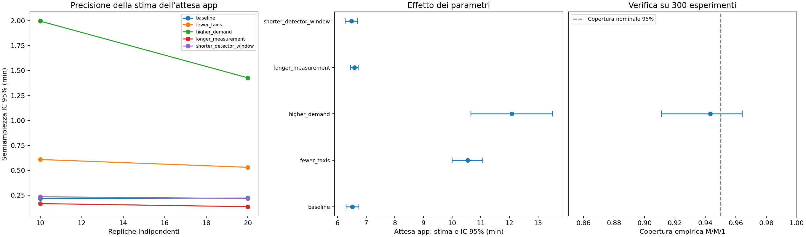

# Laboratorio: transitorio e intervalli di confidenza

Risultati riproducibili dello studio a domanda e velocità costanti. Gli scenari giornalieri del primo laboratorio restano separati.

I piloti scelgono il tempo da scartare; le repliche di misura usano stream indipendenti dai piloti. Gli IC sono Student-t tra medie di replica. La stabilità rilevata è un controllo euristico, non una prova matematica. Gli IC hanno copertura nominale, non una garanzia sul sistema taxi.

| Scenario | Piloti con rilevamento | Scarto (ore) | Repliche | Attesa app (min) | IC 95% (min) | Semiampiezza relativa |
| --- | ---: | ---: | ---: | ---: | --- | ---: |
| baseline | 3/3 | 13.0 | 20 | 6.524 | [6.300, 6.747] | 3.4% |
| fewer_taxis | 3/3 | 15.0 | 20 | 10.539 | [10.008, 11.071] | 5.0% |
| higher_demand | 3/3 | 19.0 | 20 | 12.079 | [10.651, 13.508] | 11.8% |
| longer_measurement | 3/3 | 13.0 | 20 | 6.592 | [6.455, 6.729] | 2.1% |
| shorter_detector_window | 3/3 | 14.5 | 20 | 6.485 | [6.266, 6.704] | 3.4% |
| overload | 0/3 | — | — | — | warmup_not_detected | — |

## Impatto sulla precisione

Per ciascuna configurazione il piano confronta due numerosità fissate prima della misura. La semiampiezza descrive la precisione; non misura direttamente il bias residuo del transitorio.

- baseline: passando da 10 a 20 repliche, la semiampiezza passa da 0.218 a 0.223 minuti.
- fewer_taxis: passando da 10 a 20 repliche, la semiampiezza passa da 0.610 a 0.532 minuti.
- higher_demand: passando da 10 a 20 repliche, la semiampiezza passa da 1.996 a 1.428 minuti.
- longer_measurement: passando da 10 a 20 repliche, la semiampiezza passa da 0.168 a 0.137 minuti.
- shorter_detector_window: passando da 10 a 20 repliche, la semiampiezza passa da 0.236 a 0.219 minuti.

Il caso `longer_measurement` raddoppia la durata utile da 24 a 48 ore; `shorter_detector_window` dimezza la finestra da 12 a 6 batch. Gli altri confronti modificano flotta e carico. Per confrontare l'accuratezza guardare gli IC, lo scarto e le mancate rilevazioni insieme: un intervallo stretto da solo non esclude un bias.

I confronti di numerosità condividono il prefisso delle stesse repliche, ma non effettuano arresto adattivo. Gli IC riportati sono marginali, non simultanei su tutti i parametri e non IC delle differenze.

## Verifica con un riferimento noto

Su 300 esperimenti M/M/1, ciascuno con 20 repliche e 3000 clienti per replica, la copertura osservata è 94.3% (nominale 95%; intervallo Wilson sulla copertura [91.1%, 96.4%]). L'attesa media teorica è 1; la stima media è 1.0016.

Questa verifica usa attese correlate dentro ogni replica e una distribuzione iniziale esattamente stazionaria. Controlla il metodo degli IC su una coda nota; non certifica il rilevatore del transitorio o la copertura degli IC taxi.

## Limiti e file

- `warmup_not_detected`: almeno un pilota non supera il controllo entro l'orizzonte massimo. Non equivale da solo a una prova di instabilità.
- `incomplete_measurements`: almeno una replica del campione ha clienti non ancora saliti a fine follow-up o una popolazione vuota. Non si eliminano repliche fallite per ottenere un IC.
- La produzione mantiene gli arrivi durante il follow-up della coorte; le quote di utilizzo rimangono riferite alla sola finestra utile.
- Le soglie del rilevatore sono configurabili e non garantiscono l'assenza di transitori lenti. Aumentare durata e finestre serve come controllo di sensibilità.
- Per istruzioni e formule vedere `README_STATIONARY.md`.

